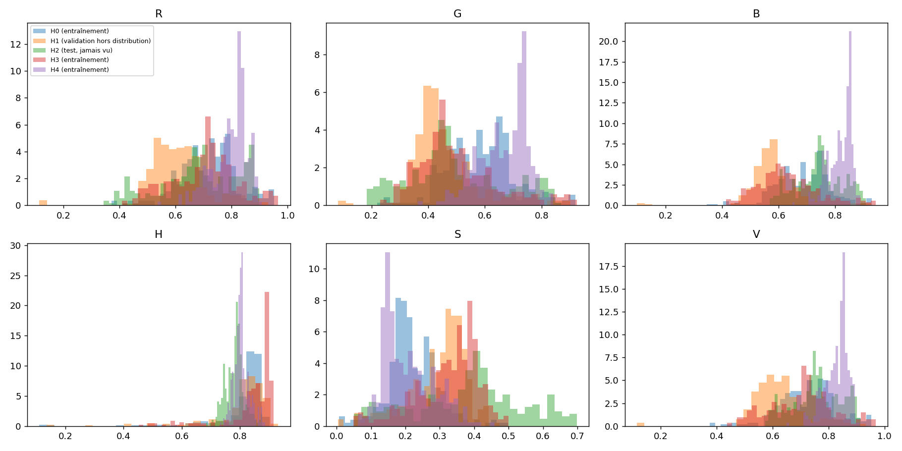
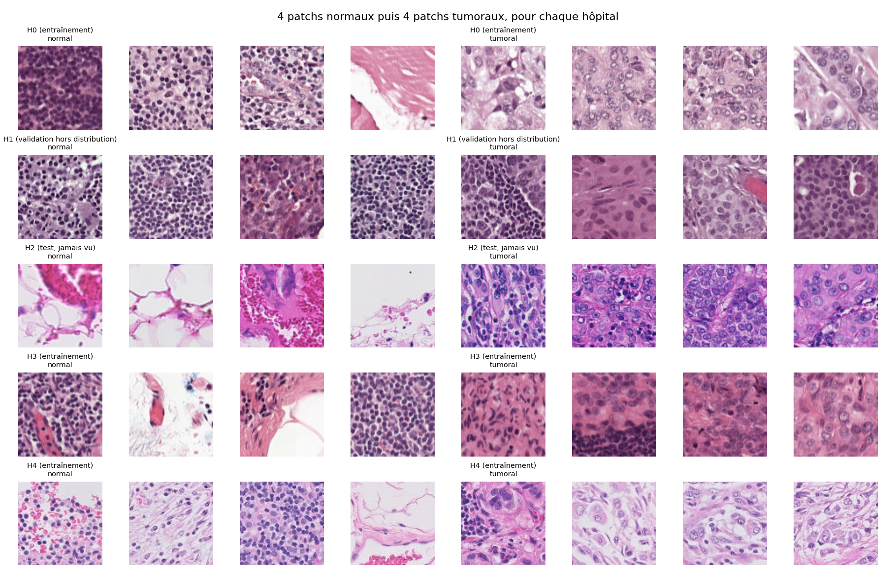

# 02 — Exploration et préparation des données

*Phase 2 du PLAN.md — Étape 2 de l'énoncé. Code : [notebooks/01_eda.ipynb](../../notebooks/01_eda.ipynb) et `src/data.py`. Tous les chiffres ci-dessous viennent de [outputs/metrics/02_donnees.json](../metrics/02_donnees.json), sauf mention contraire (déjà sourcée en Phase 0).*

## Répartition des données

Les métadonnées complètes couvrent 455 954 patchs, 50 lames annotées, 43 patientes, exactement 10 lames par hôpital. Le découpage officiel WILDS est strictement aligné sur les hôpitaux : `train` = hôpitaux 0/3/4, `id_val` = mêmes hôpitaux (mêmes lames que `train`, à ne pas confondre avec une vraie validation indépendante), `val_ood` = hôpital 1, `test` = hôpital 2. Le sous-échantillon fourni (39 000 patchs) respecte ce découpage et est équilibré à 50/50 par hôpital et par classe (vérifié par jointure exhaustive sur `image_id`, 39 000/39 000).

## Trois constats chiffrés

**1. Le shift de couleur entre hôpitaux est net et mesurable, pas seulement visuel.** Sur un échantillon de 300 patchs par hôpital, la saturation HSV moyenne va de 0,206 (hôpital 4) à 0,379 (hôpital 2, l'hôpital de test) — un facteur 1,8. Le canal bleu moyen va de 0,591 (hôpital 1) à 0,818 (hôpital 4). Les histogrammes RGB/HSV par hôpital (figure ci-dessous) montrent des distributions qui se chevauchent mais restent nettement décalées les unes des autres, en particulier sur la saturation (S) où l'hôpital 2 s'étend jusqu'à 0,7 quand les autres hôpitaux restent sous 0,5-0,6.

**2. Le décalage entre hôpitaux ne se limite pas à la teinte : netteté et quantité de fond varient aussi.** La variance du Laplacien (mesure de netteté) a une médiane de 868,7 à l'hôpital 3 contre 3 114,9 à l'hôpital 4 — un facteur 3,6. La proportion de pixels quasi blancs (fond de lame sans tissu) a une médiane de 1,0 % à l'hôpital 3 contre 15,3 % à l'hôpital 4. Aucun patch n'est entièrement blanc (0/1 500 au-delà du seuil de 90 % de pixels clairs retenu), donc aucun rejet nécessaire à ce stade, mais ces écarts confirment qu'un modèle naïf dispose de plusieurs indices non cellulaires (teinte, netteté, quantité de fond) pour deviner l'hôpital d'origine plutôt que la présence de tumeur — point à vérifier explicitement avec Grad-CAM en Phase 8.

**3. Même le jeu « complet » (455 954 patchs) reste artificiellement proche de l'équilibre, et la difficulté varie énormément d'une lame à l'autre.** Sur l'ensemble `train`, on compte 151 046 patchs non tumoraux pour 151 390 tumoraux (écart de 0,2 %) ; sur `test` et `val_ood`, l'équilibre est exactement 50/50. Ce n'est pas un hasard : Camelyon17-WILDS n'extrait des patchs que depuis les 50 lames annotées, **toutes positives**, selon une stratégie d'échantillonnage déjà pensée pour l'apprentissage — ce n'est donc pas davantage représentatif de la prévalence clinique réelle que ne l'est le sous-échantillon de 39 000 patchs. Par ailleurs, le nombre de patchs par lame varie de 888 à 61 110 (facteur 69), et la part de tissu tumoral au sein d'une lame positive varie de 0,10 % (médiane 0,46 %) pour les cellules isolées à 24,7–92,8 % (médiane 64,7 %) pour les macro-métastases : des lames très différentes en difficulté se retrouvent traitées de façon identique dans le sous-échantillon équilibré.

## Prétraitements retenus, et pourquoi

- **Aucun redimensionnement pour l'instant (96×96 conservé)** : `config.yaml::donnees.taille_entree_modele = 96`. On garde la résolution native pour la référence simple et le premier CNN (Phase 3/4), afin d'aller vite et de ne pas introduire d'artefacts de rééchantillonnage avant d'en avoir besoin. Le passage à 224×224 (pour exploiter plus finement un ResNet pré-entraîné ImageNet) est une piste à tester en Phase 4/5, pas un prétraitement figé dès l'EDA — `transform_entrainement`/`transform_evaluation` (`src/data.py`) lisent cette taille depuis `config.yaml`, donc le changement ne touchera qu'un seul paramètre.
- **Normalisation ImageNet (moyenne/écart-type standards)** : nécessaire uniquement pour les CNN pré-entraînés de la Phase 4 ; la référence simple (Phase 3) travaillera sur des histogrammes de couleur bruts, sans cette normalisation.
- **Augmentations géométriques seulement (flip horizontal, flip vertical, rotation aléatoire parmi 0°/90°/180°/270°)**, jamais de couleur à ce stade. Une lame histologique n'a pas d'orientation canonique (contrairement à une photo naturelle), donc ces augmentations sont pertinentes. À l'inverse, une augmentation de couleur (`ColorJitter`, etc.) masquerait artificiellement le shift inter-hôpital qu'on vient précisément de quantifier : elle est volontairement réservée à la Phase 5, comme une expérience contrôlée et comparée (avec/sans), plutôt que mélangée dès maintenant à l'exploration.
- **Pas de normalisation de coloration (Macenko/Reinhard) ni de niveaux de gris à ce stade**, pour la même raison : ce sont des techniques anti-shift à tester et comparer explicitement en Phase 5, pas des prétraitements par défaut.
- **Aucune pondération de classe** : le sous-échantillon est équilibré à 50/50 partout (constat ci-dessus), donc une pondération n'aurait aucun effet mesurable ici. Elle reste documentée comme option dans `src/train.py` pour la discussion sur la prévalence clinique réelle (Phase 8), où le déséquilibre redevient le problème central.
- **Découpage** : exclusivement le split officiel WILDS, par hôpital (jamais par patch). `verifier_absence_fuite` (`src/data.py`) a été exécuté sur les métadonnées complètes, le sous-échantillon et la table des lames : **aucune fuite détectée** (aucune lame ni patiente partagée entre le groupe train∪id_val, l'hôpital 1 et l'hôpital 2). `id_val` partage ses lames avec `train` par construction officielle de WILDS — documenté, pas traité comme une fuite, mais pas utilisé non plus comme une vraie validation indépendante : tous les choix du projet se feront sur `val_ood` (hôpital 1).

## Échantillon équilibré, réalité clinique déséquilibrée

Le constat 3 ci-dessus a une conséquence directe sur l'interprétation des résultats des phases suivantes : toute métrique de précision mesurée sur ce sous-échantillon (50 % de prévalence) sera mécaniquement optimiste par rapport à un déploiement clinique réel, où la grande majorité du tissu examiné est saine (prévalence de l'ordre de quelques % tout au plus). Avec une sensibilité et une spécificité données, la précision chute fortement quand la prévalence baisse (règle de Bayes) — ce recalcul quantitatif, à partir des métriques réellement mesurées sur `val_ood`/`test`, est fait en Phase 8 et non anticipé ici pour ne pas avancer de chiffre non mesuré.

## Dataset PyTorch

`src/data.py::PatchDataset` + `transform_entrainement`/`transform_evaluation` ont été testés de bout en bout sur le sous-échantillon réel : un patch donne un tenseur `torch.Size([3, 96, 96])` normalisé ImageNet, un batch de 8 donne `torch.Size([8, 3, 96, 96])`. Le chargement est reproductible (seed + `torch.Generator` passé au `DataLoader`).
