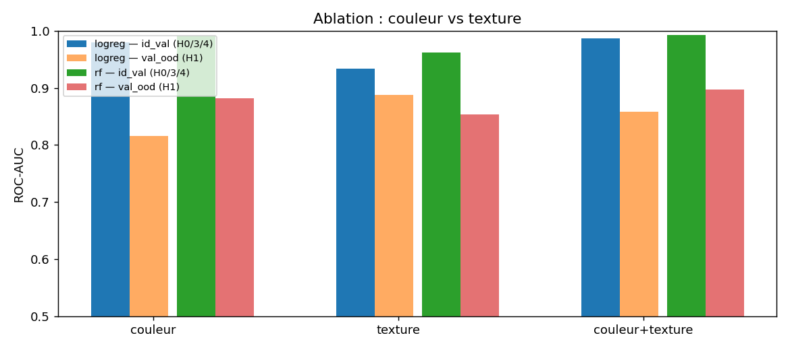
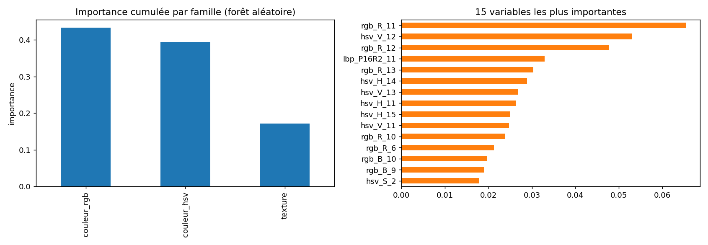

# 03 — Référence simple (Phase 3)

*Étape 3 de l'énoncé (référence obligatoire). Code : [notebooks/02_baseline.ipynb](../../notebooks/02_baseline.ipynb) et `src/features.py`. Chiffres tirés de [outputs/metrics/03_reference_simple.json](../metrics/03_reference_simple.json).*

## Variables et protocole

124 variables par patch : histogrammes de couleur RGB (48, 16 classes/canal), histogrammes HSV (48, 16 classes/canal) et texture par *local binary patterns* uniformes à deux échelles, (P=8,R=1) et (P=16,R=2) (28 variables). Deux familles de modèles (régression logistique, forêt aléatoire de 200 arbres) × trois jeux de variables (couleur seule, texture seule, couleur+texture), 24 combinaisons au total, réglées par grille sur quelques hyperparamètres (C pour la régression logistique ; profondeur et taille de feuille pour la forêt).

**Protocole strict** : entraînement sur `train` (hôpitaux 0/3/4, 24 000 patchs), choix des hyperparamètres sur **`val_ood` (hôpital 1)** et sur cette seule métrique (ROC-AUC) — jamais sur `train`, jamais sur `id_val`. `id_val` et `train` sont rapportés à titre indicatif (`id_val` partage ses lames avec `train`, donc surestime la performance, comme noté en Phase 2). **L'hôpital 2 (`test`) n'est pas touché** à ce stade, conformément à la règle absolue du projet. Seuil de décision laissé à 0,5 : le choix d'un seuil orienté rappel est traité en Phase 4, une fois le modèle principal disponible.

## Résultats : ROC-AUC par variante

| Variante | Modèle | AUC `id_val` (H0/3/4) | AUC `val_ood` (H1, hors distribution) |
|---|---|---|---|
| couleur | régression logistique | 0,980 | 0,816 |
| couleur | forêt aléatoire | 0,992 | 0,883 |
| texture | régression logistique | 0,933 | 0,888 |
| texture | forêt aléatoire | 0,962 | 0,854 |
| couleur + texture | régression logistique | 0,986 | 0,858 |
| **couleur + texture** | **forêt aléatoire** | **0,993** | **0,898** |

**Meilleur modèle retenu comme référence** : forêt aléatoire sur couleur+texture, ROC-AUC 0,993 (id_val) / **0,898 (val_ood)**. Détail par hôpital de ce modèle sur `val_ood` : rappel 0,789, précision 0,846, F1 0,816, exactitude 0,823 (seuil 0,5, 4 000 patchs de l'hôpital 1). Sur les hôpitaux d'entraînement, l'exactitude dépasse 0,97-0,98 (H0 : 0,978, H3 : 0,975, H4 : 0,986) — la chute sur l'hôpital 1 (jamais entraîné dessus) illustre directement le *domain shift* déjà quantifié en Phase 2.

## Couleur ou texture ? Un constat qui annonce un risque pour la Phase 4

Deux lectures complémentaires, et elles ne racontent pas tout à fait la même histoire :

1. **En performance brute, la couleur domine.** Un modèle couleur seule atteint déjà 0,883 de ROC-AUC sur `val_ood` (forêt aléatoire) ; ajouter la texture ne l'améliore qu'à 0,898.
2. **En généralisation hors distribution, la texture seule tient mieux la route que la couleur seule.** Pour la régression logistique, le modèle texture seule (0,888 sur `val_ood`) **dépasse** le modèle couleur seule (0,816) et même le modèle couleur+texture (0,858) — alors qu'à l'intérieur des hôpitaux d'entraînement (`id_val`), c'est l'inverse (0,933 vs 0,980 vs 0,986). Autrement dit, la couleur apporte du signal facile à exploiter *sur les hôpitaux déjà vus*, mais une partie de ce signal ne se transfère pas à un hôpital nouveau.
3. **L'importance des variables de la forêt aléatoire confirme que le meilleur modèle reste très dépendant de la couleur** : 43,3 % de l'importance totale sur les histogrammes RGB, 39,5 % sur HSV, seulement 17,2 % sur la texture. Les variables individuellement les plus importantes sont presque toutes des classes d'histogramme de couleur (`rgb_R_11`, `hsv_V_12`, `rgb_R_12`, `hsv_H_14`...) ; une seule variable de texture (`lbp_P16R2_11`) entre dans le top 4.

**Conclusion pour la suite du projet** : même cette référence simple, qui ne voit qu'un histogramme de couleur et de texture par patch (pas la morphologie cellulaire), atteint 0,90 de ROC-AUC hors distribution — en s'appuyant majoritairement sur la couleur. C'est exactement le risque identifié dans les pièges connus de l'énoncé (« apprendre la couleur au lieu des cellules ») et dans le contexte clinique (Phase 1) : si le CNN de la Phase 4 n'apporte qu'un gain marginal sur `val_ood` par rapport à ces 0,898, ou s'il perd davantage que cette référence en changeant d'hôpital, ce sera un signal fort qu'il exploite lui aussi la signature colorimétrique de l'hôpital plutôt que la morphologie cellulaire — à vérifier explicitement par Grad-CAM (Phase 8) et par les techniques anti-shift (Phase 5, dont une normalisation de coloration qui neutraliserait précisément les 83 % d'importance liés à la couleur mis en évidence ici).

## Limites de cette référence

- Seuil 0,5 non optimisé pour le rappel (traité en Phase 4).
- Hyperparamètres réglés sur une seule grille, assez grossière (4 valeurs de C, 4 combinaisons profondeur/feuilles) : suffisant pour une référence, pas pour un modèle final.
- `id_val` n'est montré qu'à titre de repère (biaisé, mêmes lames que `train`), jamais utilisé pour choisir un modèle.
