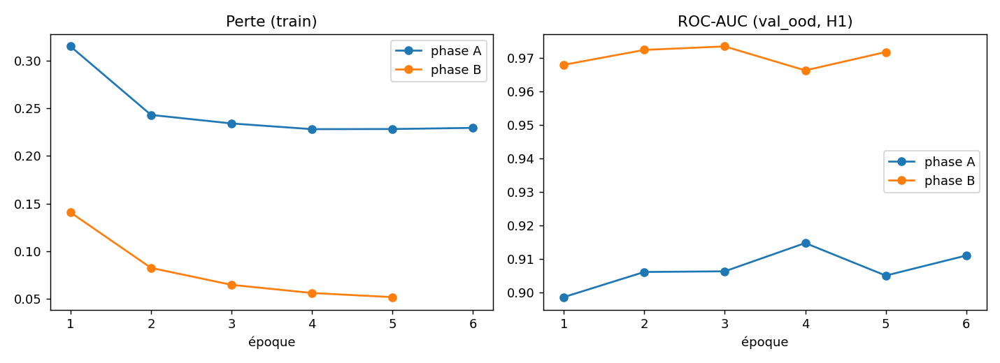

# 04 — CNN en transfert learning (Phase 4)

*Étape 3 de l'énoncé (approche principale). Code : [notebooks/03_cnn.ipynb](../../notebooks/03_cnn.ipynb) et `src/model.py`/`src/train.py`. Entraînement réel exécuté sur Colab (GPU T4) — ce run local n'avait pas de GPU disponible. Chiffres tirés de [outputs/metrics/04_cnn.json](../metrics/04_cnn.json).*

## Architecture et protocole

**ResNet18 pré-entraîné ImageNet**, choisi pour son faible coût (budget GPU gratuit) en apprentissage par transfert sur ~24 000 patchs d'entraînement — un ResNet50 aurait plus de paramètres à ajuster pour un gain incertain sur un jeu de cette taille, et n'a pas été nécessaire ici (voir résultats). Entrée 96×96 (taille native des patchs, pas de passage à 224×224 à ce stade). Deux phases :

- **Phase A** : backbone entièrement gelé, seule la tête (`fc`, 1 026 paramètres sur 11,2 M) apprend — 6 époques, `lr=1e-3`.
- **Phase B** : `layer3` et `layer4` dégelés en plus (10,5 M paramètres entraînables), `lr=1e-4` plus faible pour ajuster sans détruire les poids ImageNet — jusqu'à 8 époques prévues, **arrêt anticipé après 5** (patience 2 sans amélioration de l'AUC).

Entraînement sur `train` (hôpitaux 0/3/4), sélection du meilleur modèle et du seuil **uniquement sur `val_ood`** (hôpital 1). `id_val` rapporté à titre de repère biaisé (mêmes lames que `train`). **L'hôpital 2 n'a pas été chargé.**

## Résultats

| Phase | Époques | AUC `val_ood` (H1) | Observation |
|---|---|---|---|
| A (tête seule) | 6 | 0,899 → 0,915 (meilleure : époque 4) | plafonne autour de 0,90-0,915, progression faible et bruitée |
| B (fine-tuning) | 5 (arrêt anticipé) | 0,968 → **0,973** (meilleure : époque 3) | saut net dès la première époque, puis stabilisation |

**Meilleur modèle : ROC-AUC 0,973 sur `val_ood`**, obtenu en phase B, époque 3. C'est l'essentiel du gain : la tête seule (phase A) n'apporte qu'une amélioration marginale par rapport à la référence de la Phase 3 (voir ci-dessous), alors que dégeler `layer3`/`layer4` fait presque disparaître l'écart entre validation en distribution et hors distribution — la perte d'entraînement continue de baisser en phase B (0,141 → 0,052) pendant que l'AUC de validation progresse puis plafonne, signe que l'arrêt anticipé a bien coupé avant le surapprentissage.

### Comparaison à la référence simple (Phase 3)

| Modèle | AUC `val_ood` (H1) |
|---|---|
| Référence (couleur+texture, forêt aléatoire, Phase 3) | 0,898 |
| **CNN (ResNet18, phase B)** | **0,973** |

**+0,075 point d'AUC** par rapport à la référence. C'est un gain net et substantiel, pas marginal : le repère fixé en Phase 3 était précisément là pour détecter un CNN qui se contenterait d'exploiter la couleur de l'hôpital — ici, le CNN dépasse largement même le meilleur modèle couleur seule de la référence (0,883). Ce n'est pas une preuve qu'il regarde la morphologie cellulaire plutôt que des indices superficiels plus complexes qu'un histogramme ne peut capturer (texture fine, arrangement spatial des cellules, qui *peuvent* aussi corréler avec l'hôpital) : la vérification définitive reste Grad-CAM, Phase 8.

### Seuil 0,5 vs seuil ajusté (rappel cible 0,95)

| Seuil | Rappel | Précision | F1 | Exactitude | FN | FP |
|---|---|---|---|---|---|---|
| 0,5 (défaut) | 0,939 | 0,879 | 0,908 | 0,905 | 123 | 258 |
| **0,31 (ajusté, cible rappel ≥ 0,95)** | **0,952** | 0,849 | 0,897 | 0,891 | **97** | 339 |

Le seuil ajusté (choisi sur `val_ood` uniquement, jamais recalculé sur l'hôpital 2) fait passer le rappel de 93,9 % à 95,2 % : **26 métastases de moins manquées** sur les 4 000 patchs de l'hôpital 1 (123 → 97 faux négatifs), au prix de 81 faux positifs supplémentaires (258 → 339). Conformément au coût asymétrique des erreurs établi en Phase 1 (un faux négatif est une métastase non détectée, potentiellement un sous-staging de la patiente ; un faux positif coûte une relecture), ce compromis est cohérent avec l'objectif clinique — mais 95,2 % de rappel signifie encore, à cette échelle, plus d'une centaine de métastases manquées sur 4 000 patchs tumoraux : loin d'un système qu'on pourrait déployer sans supervision humaine.

### `id_val` : chiffre non interprétable, affiché par transparence seulement

Sur `id_val`, l'AUC ensemble atteint 0,996 (0,994-0,998 par hôpital), contre 0,973 sur `val_ood` (hôpital 1). **Cet écart de 0,023 point n'est volontairement interprété d'aucune façon** : `id_val` partage ses lames avec `train` (même patientes, même coloration, mêmes lames — construction officielle de WILDS), donc une partie de son score tient à cette fuite, pas uniquement à une absence de changement d'hôpital. On ne peut pas en déduire un « coût du changement d'hôpital » sans avoir d'abord isolé des patientes entières de `train` jamais vues à l'entraînement, ce que le calendrier du projet n'a pas permis de faire. `id_val` reste affiché uniquement pour la transparence du pipeline, jamais utilisé pour choisir le modèle ou le seuil.

**Important — hôpital 1 n'est pas « jamais vu ».** Contrairement à l'hôpital 2, l'hôpital 1 sert à *tout* régler dans ce projet (hyperparamètres de la référence, sélection du CNN, choix du seuil, et choix de variante en Phase 5). Les performances mesurées sur `val_ood` ne mesurent donc pas une généralisation aveugle : elles mesurent la performance sur l'hôpital qui a servi à tous les réglages. Seul l'hôpital 2 (Phase 6) constitue un test réellement jamais vu.

## Limites et suite

- Le modèle n'a pas encore été testé sur l'hôpital 2 : réservé à la Phase 6, une seule fois, avec ce seuil (0,31) déjà figé.
- Aucune technique anti-shift (augmentation de couleur, normalisation de coloration) n'a encore été appliquée : c'est l'objet de la Phase 5, à comparer à ces résultats sur `val_ood` toujours.
- Le gain par rapport à la référence simple est encourageant mais ne dit rien, à lui seul, sur ce que regarde le modèle : Grad-CAM (Phase 8) reste nécessaire pour trancher.
- Checkpoint sauvegardé (`outputs/models/resnet18_phaseB.pt`, non versionné, régénérable en ré-exécutant le notebook) : c'est ce modèle qui sert de base à la Phase 5.
