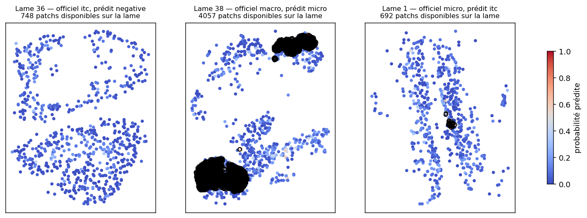

# 07 — Du patch à la patiente (Phase 7, version allégée)

*Étape 4 de l'énoncé. Code : [notebooks/05_patch_to_patient.ipynb](../../notebooks/05_patch_to_patient.ipynb), `src/aggregation.py`, `src/staging.py`. Chiffres tirés de [outputs/metrics/07_patch_to_patient.json](../metrics/07_patch_to_patient.json).*

**Portée réduite, assumée par manque de temps** (voir `PLAN.md`) : 40 des 50 lames annotées (hôpitaux 0, 1, 3, 4). Les 10 lames de l'hôpital 2 ne sont pas touchées dans cette analyse, pour garder le principe « hôpital 2, une seule fois » strictement indépendant de cette illustration qualitative. Les probabilités utilisées sont celles de la **référence simple de la Phase 3** (forêt aléatoire, couleur+texture) : cette phase ne nécessite pas de GPU et a été menée en parallèle du test final (Phase 6, sur Colab).

## Règles pN : vérifiées formellement

`src/staging.py::verifier_regles_sur_officiel` applique les règles pN simplifiées aux classes **officielles** des 50 lames et compare au stade officiel des 100 patientes : **concordance 100 %**, avec un `assert` qui ferait échouer le notebook si ce n'était pas le cas.

## Résolution physique du patch

**93,3 µm de côté par patch** (0,0933 mm), source : dépôt PatchCamelyon (`github.com/basveeling/pcam`), dont Camelyon17-WILDS reprend la méthode d'extraction — « acquisition à 40x (0,243 µm/pixel natif), patchs ré-échantillonnés à 10x ». C'est cette valeur qui convertit une zone de *n* patchs connectés en millimètres, selon les seuils officiels (ITC ≤ 0,2 mm, micro ≤ 2 mm, macro > 2 mm).

**Limite non résolue, à signaler** : les coordonnées (x_coord, y_coord) des métadonnées ont un pas observé de 32 px entre patchs voisins d'une même lame (constaté en Phase 0), plus fin que la largeur d'un patch (96 px) — signe d'un recouvrement dans la grille d'extraction officielle de WILDS, non documenté dans le dépôt `wilds`. La conversion mm ci-dessus suppose des patchs jointifs sans recouvrement (hypothèse standard PCam) : c'est une **approximation**, qui change l'échelle mais pas l'ordre de grandeur des classes.

## Classe de lame prédite : exactitude faible (27,5 %), et pourquoi

| Officiel \ Prédit | itc | micro | negative |
|---|---|---|---|
| itc | 10 | 0 | 4 |
| micro | 12 | 1 | 0 |
| macro | 4 | 9 | 0 |

**Exactitude : 27,5 % (11/40)**, avec un biais systématique très net : **aucune lame macro n'est jamais prédite macro** — la méthode sous-estime partout l'étendue de la zone tumorale.

La figure illustre deux causes qui se cumulent, visibles sur la lame macro (au centre, 4057 patchs disponibles, deux amas de vérité dense) :

1. **Couverture partielle de la lame.** Le sous-échantillon ne contient qu'une fraction des patchs de chaque lame (quelques centaines à quelques milliers, contre des dizaines de milliers au total par lame — Phase 0/2). Les composantes connexes ont besoin d'une grille dense pour reconstituer la continuité spatiale d'une métastase ; avec un échantillonnage partiel, des patchs intermédiaires manquent et une zone réellement contiguë se fragmente en points dispersés.
2. **Rappel imparfait du modèle de référence à l'intérieur même des zones tumorales.** Sur la figure, de nombreux patchs à l'intérieur des amas de vérité (cerclés de noir) restent prédits à faible probabilité (bleu) plutôt que tumoral (rouge) — cohérent avec le rappel de la référence Phase 3 sur `val_ood` (≈ 0,79 au seuil 0,5, voir `outputs/rapport/03_reference_simple.md`). Les deux effets se combinent : moins de patchs prédits positifs, eux-mêmes plus dispersés.

**La méthode d'agrégation elle-même (composantes connexes, seuils mm, règles pN) est vérifiée et fonctionne** — la limite dominante est la densité de patchs disponibles et la performance du modèle source, pas la logique d'agrégation. Avec les métadonnées complètes (455 954 patchs) ou des lames entières (option avancée du sujet), ou avec le CNN final (bien meilleur rappel, Phase 4 : 0,94-0,95) à la place de la référence, la même méthode donnerait une estimation nettement plus fidèle.

## Impact sur le stade pN de la patiente

En substituant, pour les lames annotées, la classe prédite à la classe officielle : **18 stades modifiés sur 34 patientes touchées**, et **les 18 vont dans le même sens : du sous-staging** (aucun sur-staging). C'est cohérent avec le biais observé ci-dessus (jamais de macro prédite) : sous-estimer systématiquement l'étendue tumorale fait mécaniquement sous-estimer le stade. C'est l'erreur la plus grave cliniquement (voir `outputs/rapport/01_contexte.md`) — un signal fort que, avant tout usage, un système comme celui-ci devrait être calibré pour **ne jamais sous-stader**, quitte à sur-stader davantage.

## Limites

- Hôpital 2 non inclus dans cette analyse (réservé à la Phase 6).
- Modèle source = référence Phase 3, pas le CNN final (question de calendrier, pas de principe — le pipeline est identique avec n'importe quel modèle).
- Conversion mm approximative (voir ci-dessus).
- Comme déjà noté en Phase 1 : aucune patiente n'a ses 5 ganglions couverts par une annotation — le stade pN complet reste une estimation, jamais une prédiction de bout en bout.
