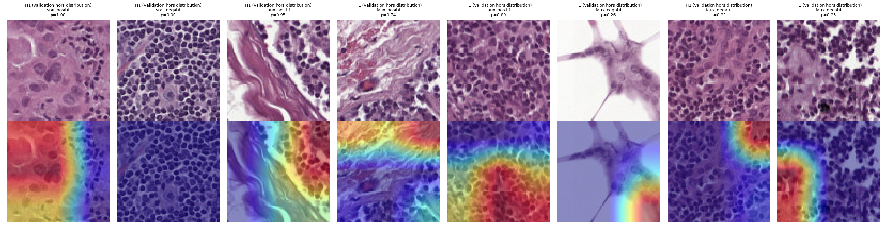

# 08 — Interprétabilité : Grad-CAM (Phase 8, version allégée)

*Étape 5 de l'énoncé. Code : [notebooks/07_interpretabilite.ipynb](../../notebooks/07_interpretabilite.ipynb), `src/interpret.py`. Exécution réelle sur Colab (modèle final de la Phase 6, seuil 0,32). Chiffres : [outputs/metrics/08_interpretabilite.json](../metrics/08_interpretabilite.json).*

Huit patchs de l'hôpital 1 (celui des réglages, voir Phase 5/6) : 1 vrai positif, 1 vrai négatif, 3 faux positifs, 3 faux négatifs.

## Ce que montrent les cartes

**Le modèle n'apprend pas *que* la couleur, mais il le fait parfois.** Sur les deux faux positifs de probabilité la plus haute (0,95 et 0,74), l'activation Grad-CAM se concentre sur des bandes de tissu fibreux/stromal rose clair, sans noyau cellulaire net dans la zone chaude — un cas concret, pas une hypothèse, où le modèle réagit à une texture/teinte de fond plutôt qu'à une morphologie tumorale. C'est exactement le risque identifié dès la Phase 3 (83 % de l'importance de la référence simple venait de la couleur) et anticipé dans les pièges connus de l'énoncé.

À l'inverse, le vrai positif (p=1,00) et les trois faux négatifs activent bien sur des zones denses en noyaux cellulaires, y compris quand le score reste sous le seuil (0,21 à 0,26) : le signal morphologique existe, mais il est parfois trop faible pour franchir 0,32 — plutôt un problème de sensibilité du signal que d'absence de signal. Le troisième faux positif (p=0,89) active sur un véritable amas cellulaire dense, donc l'erreur n'est pas systématiquement liée à la couleur.

**Conclusion** : sur ces huit exemples, le biais couleur/texture est réel et visible, mais partiel — il n'explique pas toutes les erreurs. Il reste cohérent avec l'écart de généralisation mesuré en Phase 6 (rappel 95 % sur H1, 71 % sur H2) : un modèle qui s'appuie en partie sur la texture/teinte de fond est d'autant plus vulnérable à un changement d'hôpital.

## Limites

- 8 exemples, un seul hôpital (H1) — insuffisant pour une conclusion statistique, mais conforme à la version allégée demandée par manque de temps.
- Pas de patchs de l'hôpital 2 dans cet exercice (cohérent avec la règle « hôpital 2, une seule fois », déjà consommée en Phase 6).
